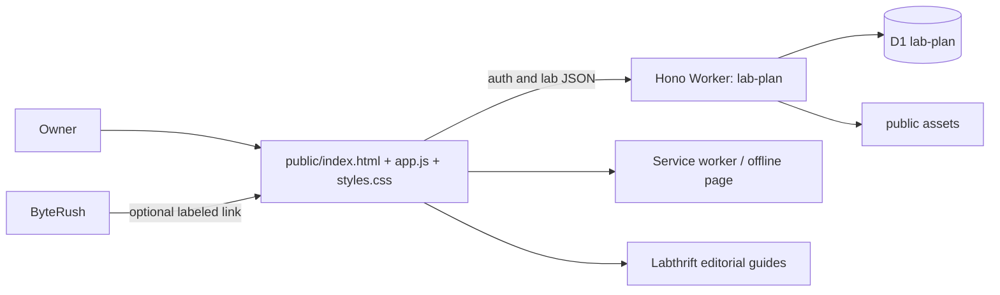

# Labthrift Plan — High-Level Design

> Baseline: 2026-10-03. Product: Labthrift Plan. Repository: `zemdregon/labthrift-plan`. Source-grounded design baseline; deployment and acceptance evidence is tracked separately in [release status](release-status.md).

## Architecture

Plan is a separate deployment and database. The Worker serves the SPA, handles WebAuthn/authenticated lab routes, sanitizes notebook content and writes aggregate metrics. D1 tables own users, passkeys, sessions, challenges, enrollment tokens, labs and aggregate metrics. There is no ByteRush progress table in Plan.

## Data boundaries
One authenticated user owns one lab. Client-supplied object IDs or user fields do not select a different owner; routes derive the user from the session. The notebook contains user-entered facts and intentions. External source-guide links are navigation, not service integration or account federation.

## Operations
Wrangler binds `DB` to `lab-plan`, with migrations under `migrations/`. Public files are served from `public/`. The configured custom domain is `plan.labthrift.com`; preview deployment is also enabled. A service worker handles shell/static caching and offline fallback, not a standalone offline account server.

## Runs impact
The retirement sequence removes only Runs infrastructure. Plan’s Worker, database, domain, lab rows and credentials remain. ByteRush absorbs guided learning, including the explanatory Plan passkey project. Future SSO or inventory synchronization would cross an explicit trust/data boundary and requires a new ADR and migration plan.
